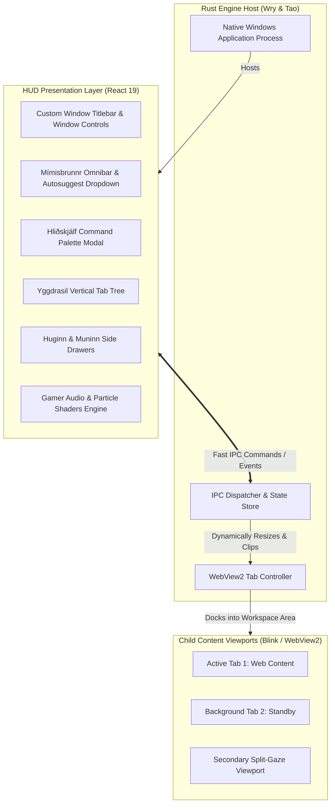

# ᛗ MÍMIR
### *The Hypermodern, Runic-Forged Web Explorer*

[](https://github.com/indoctrinatedrecluse/Mimir/releases/tag/v0.6.0)
[-00f5ff?style=for-the-badge&logo=windows&logoColor=white)](https://github.com/indoctrinatedrecluse/Mimir)
[](https://github.com/tauri-apps/wry)
[](https://vitejs.dev/)
[](https://tailwindcss.com/)
[](LICENSE)

> *"He who drinks from Mímisbrunnr gains wisdom beyond mortal reckoning."*  
> Mímir is a next-generation desktop browser crafted for gamers, power users, and mythology enthusiasts. It strips away sterile corporate browser design in favor of a responsive, obsidian-glass, gamer-grade HUD deeply rooted in Norse cosmology.

---

## ⚡ Download Mímir (v0.6.0)

Ready-to-use releases for 64-bit Windows are packaged and distributed with zero manual prerequisites:

| Package | Format | Description |
| :--- | :--- | :--- |
| [**Windows Setup Installer**](https://github.com/indoctrinatedrecluse/Mimir/releases/download/v0.6.0/mimir-v0.6.0-windows-x64-setup.exe) | `.exe` (~10 MB) | Full setup wizard with Desktop and Start Menu shortcuts, auto-launch option, and bundled Microsoft WebView2 Evergreen Bootstrapper for fresh or LTSC Windows systems. |
| [**Portable Archive**](https://github.com/indoctrinatedrecluse/Mimir/releases/download/v0.6.0/mimir-v0.6.0-windows-x64-portable.zip) | `.zip` (~8 MB) | Standalone portable bundle. Extract and launch `mimir.exe` directly without installation. |

---

## 🧭 Purpose & Vision

Modern browsers have devolved into monotonous gray rectangles that treat the internet as a corporate spreadsheet. **Mímir** explores what happens when a browser is designed with:
1. **Sensory & Visual Tactility**: Deep obsidian textures, neon runic accents, spring physics, and subtle mechanical audio feedback for every click, tab shift, and command execution (reminiscent of high-end game launchers and cybernetic HUDs).
2. **Deep Mythological Lore**: Every feature is named and conceptualized around Norse cosmology. The browser is not just an application—it is your conduit across the digital Nine Realms.
3. **High Performance & Low Footprint**: By utilizing a native **Rust core (`wry`)** on top of Windows' **Evergreen WebView2 (Chromium Blink)**, Mímir delivers 100% web compatibility with minimal RAM overhead compared to traditional Electron wrappers.

---

## ⚡ Tech Stack Decision & Rationale

```
┌────────────────────────────────────────────────────────────────────────┐
│                        MÍMIR ARCHITECTURE DUALITY                      │
├───────────────────────────────────┬────────────────────────────────────┤
│ 🛡️ BACKEND / ENGINE LAYER          │ ᚱ FRONTEND / HUD LAYER             │
├───────────────────────────────────┼────────────────────────────────────┤
│ • Rust (Cargo)                    │ • React 19 (TypeScript)            │
│ • Wry + Tao Window Manager        │ • Vite (Instant HMR)               │
│ • Microsoft Edge WebView2 (Blink) │ • Tailwind CSS v4 (Custom Tokens)  │
│ • Native IPC & Process Isolation  │ • Framer Motion (Spring Physics)   │
│ • Windows Subsystem Targeting     │ • Web Audio API (Runic Cues)       │
└───────────────────────────────────┴────────────────────────────────────┘
```

* **Why Wry on WebView2?**  
  Windows WebView2 provides full Chromium/Blink rendering fidelity (YouTube, WebGL, WebGPU, DRM, 144Hz+ displays) without bundling a 150MB+ Chromium binary or running heavy Node.js background services.
* **Why React 19 + Framer Motion?**  
  Delivers unparalleled animation fluidity (`layoutId` shared-element transitions, spring physics on tab snapping) and access to the world's richest component ecosystem.
* **Why Tailwind v4 + OKLCH?**  
  Prevents neon glow clipping in dark mode; enables glowing runic glassmorphism with high rendering performance.

---

## ᚱ Thematic Taxonomy (Norse Feature Glossary)

Every standard browser function is rechristened into ancient Norse cosmology:

| Traditional Element | Mímir Norse Codename | Lore & Purpose |
| :--- | :--- | :--- |
| **Omnibar / Search** | **Mímisbrunnr** | *The Well of Wisdom.* The central command bar, search engine, and runic launcher. |
| **Autosuggest** | **Mímisbrunnr Whispers** | Real-time frecency ranking delivering bookmarked Runestones, history threads, and portals as you type. |
| **Command Palette** | **Hliðskjálf** | *The High Seat of Odin.* Editor-grade omnipresent command center (`Ctrl+K` / `Ctrl+Shift+P`) overlooking all browser operations. |
| **Tabs & Tab Trees** | **Yggdrasil Branches** | The great World Tree holding your active web threads, collapsible into glowing runes. |
| **History & Cache** | **Muninn** | *Memory.* Raven that recalls every realm and journey traversed (`Ctrl+M`). |
| **Quick AI Scout** | **Huginn** | *Thought.* Raven that scours pages for summaries, architecture, and security audits (`Ctrl+H`). |
| **Bookmarks** | **Runestones** | Sacred marks carved into the browser to anchor important destinations. |
| **Dual Viewports** | **Odin's Split-Gaze** | Side-by-side split-screen browsing container with instant pane swapping (`Ctrl+\`). |
| **Incognito Mode** | **Helheim Cloak** | Zero-trace icy cloaking. Leaves no footstep across memory or disk. |
| **Ambient Audio** | **Gjallarhorn Soundscape** | Procedural Web Audio synthesizer generating unique living soundscapes for each realm. |
| **Workspaces & Themes** | **The Nine Realms** | Dedicated realm spaces with sovereign ruler artwork, lore, and independent network routing. |
| **Proxy & DoH Routing** | **Bifröst Conduit Matrix** | Per-realm proxy routing (Direct, SOCKS5, HTTP, Tor) and encrypted DNS-over-HTTPS resolvers. |
| **Extension Engine** | **Brokkr's Forge** | User-scripts and custom runic CSS/JS style injection engine for power customization. |
| **Adblock & Shields** | **Runic Ward** | Defensive runic barrier deflecting trackers, banners, and malicious script intrusion. |
| **Lock Icon / Security** | **Sacred Cipher Ward** | Clickable HTTPS status indicator revealing TLS cipher, certificate authority, tracker count, and per-site permissions. |
| **Find in Page** | **Rune Seeker** | Floating search overlay (`Ctrl+F`) scanning active WebView for matching text runes. |
| **Downloads** | **Mímir's Hoard** | Collected manuscripts and acquired artifacts stored by the great sage (`Ctrl+J`). |
| **Clear Browsing Data** | **Fate Thread Purge** | Selective obliteration of history, cookies, cache, and localStorage across chosen time spans (`Ctrl+Shift+Del`). |
| **Zoom Controls** | **Realm Gaze Magnification** | Per-tab zoom controls in the Omnibar (`Ctrl++` / `Ctrl+-` / `Ctrl+0`). |
| **Tab Pinning** | **Branch of Fate Anchor** | Locks a tab branch against accidental severance; shown with amber accent dot. |
| **Duplicate Tab** | **Fate Thread Clone** | Spawns an identical branch from the current URL and realm. |

---

## 🏛️ System Architecture

Mímir operates using a **Decoupled HUD Architecture**:



---

## 🎯 Feature Evolution & Roadmap

### Phase 0: Scaffolding & Foundation *(Completed in v0.1.0)*
- [x] Project architecture blueprint & technical specification.
- [x] Modular workspace setup (Rust backend + React 19 Vite frontend).
- [x] Establish typed IPC contract between Rust and React.
- [x] Initialize Obsidian Glass design tokens and typography.

### Phase 1: The Runic Frame (UI-First Prototype) *(Completed in v0.1.0)*
- [x] Custom borderless window frame with integrated titlebar and window controls.
- [x] **Mímisbrunnr (Omnibar)** with runic glow focus, keyboard hotkeys, and suggestions HUD.
- [x] **Yggdrasil Tab Bar** (vertical & collapsible) with spring-physics tab switching.
- [x] Tactile sound engine (subtle mechanical clicks, low-frequency hums on realm switches).
- [x] Ambient canvas rune particles / ember effects.

### Phase 2: Live Content Docking (Wry Integration) *(Completed in v0.1.0)*
- [x] Rust process spawning child WebView2 viewports inside the React frame workspace.
- [x] Dynamic bounds synchronization (resizing HUD cleanly adjusts the webview).
- [x] URL navigation, Back / Forward / Refresh controls bound to Mímisbrunnr.
- [x] Multi-tab lifecycle: Tab creation, switching, closing, and memory hibernation.
- [x] COM apartment re-entrancy fix decoupling IPC handlers from synchronous child creation.
- [x] Embedded `https://mimir.localhost` custom protocol eliminating CORS blocks on ES modules.

### Phase 3: The Nine Realms & Sovereign Wisdom *(Completed in v0.2.0)*
- [x] **The Nine Realms Cosmology**: Full realization of all 9 Norse realms (Midgard, Asgard, Vanaheim, Alfheim, Jotunheim, Muspelheim, Niflheim, Nidavellir, Helheim) with sovereign ruler artwork and palettes.
- [x] **Muninn's Memory Vault**: Persistent Runestones bookmarks and Threads of Fate history tree (`Ctrl+M`).
- [x] **Gjallarhorn Procedural Ambient Soundscapes**: Continuous Web Audio procedural drone synthesizer for all 9 realms.
- [x] **Bifröst Proxy Conduit Matrix**: Per-realm proxy and encrypted DoH resolver routing.
- [x] **Odin's Split-Gaze**: *Hliðskjálf* dual-viewport split-screen browsing (`Ctrl+\`).
- [x] **Brokkr's Extension Forge**: Custom CSS/JS user-script injection engine.
- [x] **Huginn AI Scout**: Floating Norse AI companion drawer (`Ctrl+H` / `Ctrl+I`).
- [x] **Helheim Mode**: Zero-trace private browsing sessions.

### Phase 4: Autosuggest & Command Center *(Completed in v0.3.0)*
- [x] **Intelligent Omnibar Autosuggest**:
  - Multi-source frecency ranking engine evaluating Runestone bookmarks, visited history, and developer portals.
  - Scoring factors: exact domain match (+150), prefix match (+110), full URL substring (+75), title match (+55), bookmark intent (+40), visit frequency (+8 per visit up to +40), and recency decay.
  - Keyboard navigation (`ArrowDown`/`ArrowUp`) with live URL bar auto-population and runic badges (`ᛚ RUNESTONE`, `ᚺ HISTORY`, `ᛟ GATEWAY`, `ᛋ SEARCH`).
- [x] **Hliðskjálf Command Palette**:
  - Editor-grade modal command center accessible via dedicated trigger on the left pane (above tabs) and via `Ctrl+K` / `Ctrl+Shift+P`.
  - Categorized actions: Tabs & Navigation, Wisdom & Ravens, Viewports & Tools, The Nine Realms, and System & Wards.
- [x] **Cosmic Realm Highlighting & Lore Refinement**:
  - Synchronized active realm state with bound tab workspaces.
  - Active realm indicators with distinct accent glows, borders, and pulsing runic status dots.
  - Expanded lore layout removing truncation on ruler titles, quotes, and Hávamál verses.

### Phase 5: Sacred Wards, Browser Mastery & Privacy Controls *(Completed in v0.4.0)*
- [x] **Security Ward Widget (HTTPS Lock Icon)**: Clickable lock icon exposing TLS cipher suite, certificate authority, OCSP status, Runic Shield tracker blocker toggle, and per-site permission controls.
- [x] **Rune Seeker (Find in Page)**: Floating `Ctrl+F` text search overlay with prev/next navigation, IPC-backed `window.find()` integration.
- [x] **Mímir's Hoard (Full Native Downloads Manager)**: `Ctrl+J` panel with real WebView2 native download hooks, real-time download telemetry (`DOWNLOAD_STARTED` / `DOWNLOAD_COMPLETED`), open file, reveal in Windows Explorer (`explorer.exe /select`), disk file deletion, and manual background URL acquisition via `curl.exe`.
- [x] **Norse Themed Context Menu**: Custom obsidian right-click menu replacing default browser context menu with link actions, image saving, selection searching, quick bookmarking, printing, and DevTools.
- [x] **True Helheim Isolation**: Separate ephemeral `WebContext` targeting `%TEMP%\mimir_helheim_isolated` for Helheim tabs (strict zero-trace cookie/storage/cache separation).
- [x] **Runic Shield Ad & Tracker Protection**: Injected script blocker neutralizing telemetry requests to known tracker networks with real-time HUD counter updates.
- [x] **HTTPS-Only Mode & "Seal Passage" Upgrade**: Direct one-click elevation of unencrypted HTTP connections in `SecurityWardWidget`.
- [x] **Runestone Vault JSON Import & Export**: Full bookmark export and import with schema validation and audio feedback in `MuninnVault`.
- [x] **Yggdrasil Tab Drag-and-Drop Reordering**: Framer Motion `Reorder.Group` physics for smooth branch repositioning.
- [x] **Brokkr's Extension Forge — Live Script & Style Inscription**: User-scripts and custom CSS/JS with live DOM injection via `EXECUTE_SCRIPT` IPC.
- [x] **Bifröst Matrix Conduits & Probe**: Per-realm proxy configs, DoH resolvers, and live latency probing.
- [x] **Fate Thread Purge (Clear Browsing Data)**: `Ctrl+Shift+Del` modal with time range selector and granular data category toggles.
- [x] **Omnibar Zoom Controls**: Inline Zoom In / Zoom % Reset / Zoom Out cluster with per-tab IPC-backed `document.body.style.zoom` control.
- [x] **Print Page**: `Ctrl+P` dispatches `window.print()` via IPC.
- [x] **Tab Pinning & Duplication**: Pin/Unpin tabs via hover micro-button; duplicate tab with `Copy` icon via IPC.
- [x] **Persistent Theme Selection**: Active realm auto-saved to `localStorage`; restored on next launch.
- [x] **Command Palette Expansion**: Find, Downloads, Zoom, Print, Pin, Duplicate, and Clear Data all callable from Hliðskjálf.

### Phase 6: Valhalla Revival, Turbo Acceleration & Naglfar Swarm *(Completed in v0.5.0)*
- [x] **Bifröst Turbo Multi-Strand Accelerator**: Native parallel byte-range chunked downloading engine with isolated `.strand_{i}` parts, live aggregate speeds, ETA telemetry, and temporary strand cleanup.
- [x] **Naglfar Swarm BitTorrent Engine**: Pure Rust BitTorrent client powered by `librqbit` (v9.0) supporting magnet URIs (`magnet:?xt=...`), local `.torrent` file parsing (via base64 and native file picker), automatic webview download interception, peer telemetry, and piece verification.
- [x] **Valhalla Revival & Crash Sentinel**: Continuous state preservation, unexpected halt detection, and one-click session hierarchy restoration banner.
- [x] **Reader Sanctum**: Cleanse web pages into distraction-free Obsidian, Elder Parchment, and Rune Sepia reading views (`Alt+R`) with text-to-speech recitation.
- [x] **Runic Sidecar**: Docked persistent sidebar panel (`Ctrl+B`) featuring Scratchpad Notes, concurrent Huginn AI Skáli, and live conduit network telemetry.
- [x] **Realm Inscription Rules Engine**: Define and auto-inject domain user-scripts and CSS rules matched by URL glob patterns and realm tags.

### Phase 7: Living Animated Sanctums & Hliðskjálf Universal Integration *(Completed in v0.6.0)*
- [x] **Animated Realm Sanctums (Option A: Atmospheric Particles & Ken Burns Drift)**:
  - Dynamic 42-second GPU-accelerated Ken Burns ambient drift on realm sovereign artwork.
  - Native HTML5 Canvas particle simulations tailored to each realm (Muspelheim embers, Niflheim frost mist, Asgard auroras, Helheim soul wisps, Jotunheim blizzards, Nidavellir sparks, Vanaheim nature spores).
  - Quick-toggle button in the bottom realm switcher bar (`MOTION: ON / STATIC`) and `Ctrl+K` command for instant switching.
  - Zero performance footprint: 0 MB added download bloat, auto-pausing on tab/window hide, and `prefers-reduced-motion` compliance.
- [x] **Hliðskjálf Command Palette Universal Integration**:
  - Direct keyboard accessibility for Naglfar Swarm (`Ctrl+Shift+U`), Bifröst Turbo (`Ctrl+Shift+J`), Reader Sanctum (`Alt+R`), Runic Sidecar (`Ctrl+B`), Valhalla Revival, and Atmospheric Realms.
- [x] **Future Visual Upgrade Roadmap (Option B)**:
  - *Roadmap*: Future major iterations will introduce **Option B: Seamless Looping Cinematic Generative Video Backgrounds** with user-selectable Video / Particle FX / Static modes.

---

## ⌨️ Essential Keyboard Shortcuts

| Shortcut | Action |
| :--- | :--- |
| `Ctrl + K` / `Ctrl + Shift + P` | Open **Hliðskjálf Command Palette** |
| `Ctrl + Shift + U` | Open **Naglfar Swarm** (BitTorrent Client) |
| `Ctrl + Shift + J` | Open **Bifröst Turbo** (Download Accelerator) |
| `Ctrl + B` | Toggle **Runic Sidecar** (Docked Scratchpad & Notes) |
| `Alt + R` | Enter **Reader Sanctum** (Distraction-Free Reading) |
| `Ctrl + T` | Open New Tab (Branch of Yggdrasil) |
| `Ctrl + W` | Sever Active Tab Thread (if not pinned) |
| `Ctrl + L` | Focus **Mímisbrunnr (Omnibar)** |
| `Ctrl + H` / `Ctrl + I` | Summon **Huginn AI Scout** |
| `Ctrl + M` | Open **Muninn's Memory Vault** |
| `Ctrl + \` / `Ctrl + U` | Toggle **Odin's Split-Gaze** (Dual Viewports) |
| `Ctrl + F` | Open **Rune Seeker** (Find in Page) |
| `Ctrl + J` | Open **Mímir's Hoard** (Downloads Manager) |
| `Ctrl + P` | **Inscribe Parchment** (Print Page) |
| `Ctrl + +` / `Ctrl + -` | Zoom In / Zoom Out |
| `Ctrl + 0` | Reset Zoom to 100% |
| `Alt + 1` .. `Alt + 9` | Instant Realm Teleportation |
| `Ctrl + Shift + Del` | **Fate Thread Purge** (Clear Browsing Data) |
| `Escape` | Dismiss Active Modal, Command Palette, or AI Drawer |

---

## 🛠️ Development Setup (Windows)

### Prerequisites
* **Node.js**: `v20+` (Recommended `v22+`)
* **Rust**: `1.80+` with the `x86_64-pc-windows-msvc` target
* **Build Tools**: Visual Studio C++ Build Tools (with Windows 10/11 SDK)
* **WebView2**: Standard on modern Windows 10/11 systems

### Quick Start
```bash
# 1. Install frontend dependencies
npm install

# 2. Compile UI bundle
npm run build:ui

# 3. Launch full native browser application (Rust + Wry + React)
cargo run --manifest-path src-rust/Cargo.toml
```

### Building for Release
```bash
# Build production UI bundle
npm run build:ui

# Compile optimized native Windows binary
cargo build --release --manifest-path src-rust/Cargo.toml
```

---

<div align="center">
  <sub>Forged in the roots of Yggdrasil. Protected by the wisdom of Mímir.</sub>
</div>
