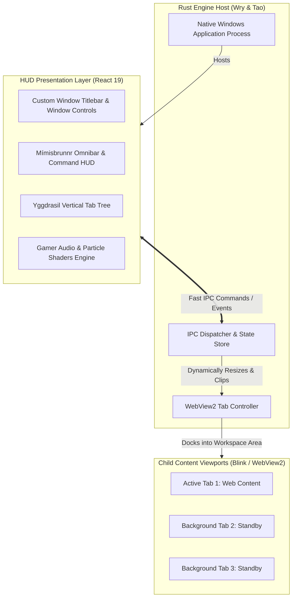

# ᛗ MÍMIR
### *The Hypermodern, Runic-Forged Web Explorer*

[-00f5ff?style=for-the-badge&logo=windows&logoColor=white)](https://github.com/indoctrinatedrecluse/Mimir)
[](https://github.com/tauri-apps/wry)
[](https://vitejs.dev/)
[](https://tailwindcss.com/)

> *"He who drinks from Mímisbrunnr gains wisdom beyond mortal reckoning."*  
> Mímir is a next-generation desktop browser crafted for gamers, power users, and mythology enthusiasts. It strips away sterile corporate browser design in favor of a responsive, obsidian-glass, gamer-grade HUD deeply rooted in Norse lore.

---

## 🧭 Purpose & Vision

Modern browsers have devolved into monotonous gray rectangles that treat the internet as a corporate spreadsheet. **Mímir** is an exploration of what happens when a browser is designed with:
1. **Sensory & Visual Tactility**: Deep obsidian textures, neon runic accents, spring physics, and subtle mechanical audio feedback for every click and tab shift (reminiscent of high-end game launchers and cybernetic HUDs).
2. **Deep Mythological Lore**: Every feature is named and conceptualized around Norse cosmology. The browser is not just an app—it is your conduit across the digital Nine Realms.
3. **High Performance & Low Footprint**: By utilizing a native **Rust core (`wry`)** on top of Windows' **Evergreen WebView2 (Chromium Blink)**, Mímir delivers 100% web compatibility with minimal RAM overhead compared to traditional Electron wrappers.

---

## ⚡ Tech Stack Decision & Rationale

```
┌────────────────────────────────────────────────────────────────────────┐
│                        MÍMIR ARCHITECTURE DUALITY                      │
├───────────────────────────────────┬────────────────────────────────────┤
│ 🛡️ BACKEND / ENGINE LAYER          │ ᚱ FRONTEND / HUD LAYER             │
├───────────────────────────────────┼────────────────────────────────────┤
│ • Rust (Cargo)                    │ • React 19 (TypeScript)            │
│ • Wry + Tao Window Manager        │ • Vite (Instant HMR)               │
│ • Microsoft Edge WebView2 (Blink) │ • Tailwind CSS v4 (Custom Tokens)  │
│ • Native IPC & Process Isolation  │ • Framer Motion (Spring Physics)   │
│ • Windows Subsystem Targeting     │ • Web Audio API (Runic Cues)       │
└───────────────────────────────────┴────────────────────────────────────┘
```

* **Why Wry on WebView2?**  
  Windows WebView2 provides full Chromium/Blink rendering fidelity (YouTube, WebGL, WebGPU, DRM, 144Hz+ displays) without bundling a 150MB+ Chromium binary or running heavy Node.js background services.
* **Why React 19 + Framer Motion?**  
  Delivers unparalleled animation fluidity (`layoutId` shared-element transitions, spring physics on tab snapping) and access to the world's richest component ecosystem.
* **Why Tailwind v4 + OKLCH?**  
  Prevents neon glow clipping in dark mode; enables glowing runic glassmorphism with high rendering performance.

---

## ᚱ Thematic Taxonomy (Norse Feature Glossary)

Every standard browser function is rechristened into ancient Norse cosmology:

| Traditional Element | Mímir Norse Codename | Lore & Purpose |
| :--- | :--- | :--- |
| **Omnibar / Search** | **Mímisbrunnr** | *The Well of Wisdom.* The central command bar, search engine, and runic launcher. |
| **Tabs & Tab Trees** | **Yggdrasil Branches** | The great World Tree holding your active web threads, collapsible into glowing runes. |
| **History & Cache** | **Muninn** | *Memory.* Raven that recalls every realm and journey traversed. |
| **Quick AI Scout** | **Huginn** | *Thought.* Raven that scours pages for summaries, answers, and insights. |
| **Bookmarks** | **Runestones** | Sacred marks carved into the browser to anchor important destinations. |
| **Incognito Mode** | **Helheim Cloak** | Zero-trace icy cloaking. Leaves no footstep across memory or disk. |
| **Media Controller** | **Gjallarhorn** | The echoing horn that summons and commands active media/audio streams across all tabs. |
| **Workspaces / Profiles** | **The Nine Realms** | Dedicated realm spaces (e.g. *Midgard* for daily life, *Asgard* for coding/creation). |
| **Adblock & Shields** | **Runic Ward** | Defensive runic barrier deflecting trackers, banners, and malicious script intrusion. |

---

## 🏛️ System Architecture

Mímir operates using a **Decoupled HUD Architecture**:



---

## 🎯 Current Scope & Feature Roadmap

### Phase 0: Scaffolding & Foundation *(Completed in v0.1.0)*
- [x] Project architecture blueprint & technical specification.
- [x] Modular workspace setup (Rust backend + React 19 Vite frontend).
- [x] Establish typed IPC contract between Rust and React.
- [x] Initialize Obsidian Glass design tokens and typography.

### Phase 1: The Runic Frame (UI-First Prototype) *(Completed in v0.1.0)*
- [x] Custom borderless window frame with integrated titlebar and window controls.
- [x] **Mímisbrunnr (Omnibar)** with runic glow focus, keyboard hotkeys, and suggestions HUD.
- [x] **Yggdrasil Tab Bar** (vertical & collapsible) with spring-physics tab switching.
- [x] Tactile sound engine (subtle mechanical clicks, low-frequency hums on realm switches).
- [x] Ambient canvas rune particles / ember effects.

### Phase 2: Live Content Docking (Wry Integration) *(Completed in v0.1.0)*
- [x] Rust process spawning child WebView2 viewports inside the React frame workspace.
- [x] Dynamic bounds synchronization (resizing HUD cleanly adjusts the webview).
- [x] URL navigation, Back / Forward / Refresh controls bound to Mímisbrunnr.
- [x] Multi-tab lifecycle: Tab creation, switching, closing, and memory hibernation.

### Phase 3: The Nine Realms & Sovereign Wisdom *(Completed in v0.2.0)*
- [x] **The Nine Realms** workspace switcher with realm-specific mythological backgrounds & palettes.
- [x] **Muninn's Memory Vault** (Runestones bookmarks & Threads of Fate history tree).
- [x] **Gjallarhorn Procedural Ambient Soundscapes** (Continuous Web Audio synthesizer for all 9 realms).
- [x] **Bifröst Proxy Conduit Matrix** (Per-realm proxy and encrypted DoH resolver routing).
- [x] **Odin's Split-Gaze** (*Hliðskjálf* dual-viewport split-screen browsing).
- [x] **Brokkr's Extension Forge** (User-scripts and custom runic CSS/JS style injection).
- [x] **Huginn AI Scout** floating intelligence assistant drawer.
- [x] **Helheim Mode** toggle for private web sessions.

---

## 🗺️ Milestones to a Demo-Ready POC

The following checklist guides our step-by-step progress towards a working, demo-ready Proof of Concept:

```
[Milestone 1] ──> [Milestone 2] ──> [Milestone 3] ──> [Milestone 4] ──> [Milestone 5]
 Scaffolding       Runic HUD         Wry Child         Multi-Tab         Polished Demo
 & Toolchain       Interface        Viewports         Navigation           Release
```

* **Milestone 1: Repository & Scaffolding**  
  Working Rust project with Tao/Wry, paired with Vite React 19 frontend building in tandem.
* **Milestone 2: Hypermodern HUD Shell**  
  Fully interactive React UI with Mímisbrunnr bar, Yggdrasil tabs, custom window controls, animations, and sound effects running inside a borderless native window.
* **Milestone 3: Native Web Content Docking**  
  Spawning an actual WebView2 child inside the React HUD, rendering real internet sites (e.g. YouTube, GitHub) within our Norse frame.
* **Milestone 4: Multi-Tab & Omnibar Navigation**  
  Navigating via Mímisbrunnr, opening new tabs, closing tabs, and switching between live web views with smooth animated indicators.
* **Milestone 5: Demo-Ready POC Packaging**  
  Polished visual effects, realm switcher prototype, keyboard shortcuts, and standalone Windows executable generation.

---

## 🛠️ Development Setup (Windows)

### Prerequisites
* **Node.js**: `v20+` (Recommended `v24+`)
* **Rust**: `1.80+` with the `x86_64-pc-windows-msvc` target
* **Build Tools**: Visual Studio C++ Build Tools (with Windows 10/11 SDK)
* **WebView2**: Standard on modern Windows 10/11 systems

### Quick Start
```bash
# 1. Install frontend dependencies
npm install

# 2. Run HUD in development mode (Vite)
npm run dev

# 3. Launch full native browser application (Rust + Wry + React)
cargo run
```

---

<div align="center">
  <sub>Forged in the roots of Yggdrasil. Protected by the wisdom of Mímir.</sub>
</div>
